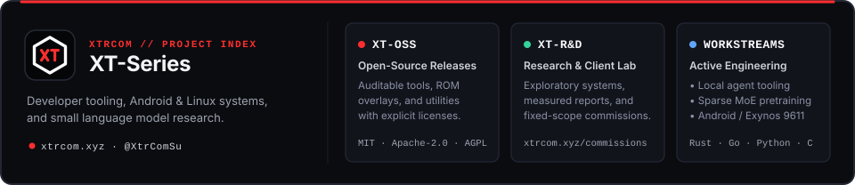

# XT-Series

  

XT-Series is the project family I build under **XtrCom** ([@XtrComSu](https://github.com/XtrComSu)). It brings together local developer tooling, Android and Linux systems work, and experiments with small language models.

**XT-OSS** is the open-source work published under that label (corresponding to the **XT-Research Open Source** catalog on [xtrcom.xyz](https://xtrcom.xyz/projects)). Each repository ships auditable code or build tooling and documents its own license, verification status, and contribution terms.

**XT-R&D** is the exploratory research and client engineering lab described on the XtrCom site (**[XT-R&D // Client Lab](https://xtrcom.xyz/commissions)**). It covers hardware and model investigations, internal prototypes, and fixed-scope commissioned work. Public architecture reports, benchmark methodology, and verified slices are linked here when the record is complete enough to be checked on its merits. A project can span both labels when exploratory research produces open-source tooling, datasets, or technical documentation.

[About XtrCom](https://xtrcom.xyz) · [Project Catalog](https://xtrcom.xyz/projects) · [XT-R&D Client Lab](https://xtrcom.xyz/commissions) · [Engineering Principles](https://xtrcom.xyz/philosophy) · [Hugging Face (`XtrCom`)](https://huggingface.co/XtrCom)

---

## Project index

| Project | Track & License | Verified status | Where to start |
| --- | --- | --- | --- |
| **[XT-Forge](https://github.com/XtrComSu/xt-forge)** Local agent workbench for call-graph context, AST correctness auditing, normalized binary diffing, keyless CVE intel, and sub-1KB MCP routing | `XT-OSS` · `MIT` | Active release [`v0.4.6-Damascus`](https://github.com/XtrComSu/xt-forge/releases/tag/v0.4.6-Damascus); 9-tier, 5-repetition benchmark (`42/45` standalone pass rate vs `10/45` raw REA) | [Quickstart & install](https://github.com/XtrComSu/xt-forge#install-on-linux-macos-and-windows) · [9-tier benchmark report](https://github.com/XtrComSu/xt-forge/blob/main/docs/BENCHMARKS.md) · [Latest release](https://github.com/XtrComSu/xt-forge/releases/latest) |
| **[XT-Luna-Zero](https://github.com/XtrComSu/XT-Luna-Zero)** Sparse mixture-of-experts language-model architecture report and single-GPU pretraining experiments | `XT-R&D` · `CC BY 4.0` | **194M design** (`XT-Luna-Zero v3`): architecture & FP32 causal-window checks verified; no real-text training. **375M model** (`XT-Luna Core`, `139M` active/token): real-text pretraining running toward `15B` tokens (`8.20B` evaluated, `32K` context switch at step `125,600`) | [194M technical report (PDF)](https://github.com/XtrComSu/XT-Luna-Zero/blob/main/paper/XT-Luna-Zero-Architecture.pdf) · [194M vs 375M models](https://github.com/XtrComSu/XT-Luna-Zero#models) · [Measured cross-entropy tables](https://github.com/XtrComSu/XT-Luna-Zero#measured-results) |
| **[XT-OSS-Exynos9611](https://github.com/XtrComSu/XT-OSS-Exynos9611)** Project Infinity X 4.2 (Android 17 / `lineage-24.0`) build overlay, local manifest, and memory tuning for Samsung Exynos 9611 devices | `XT-OSS` · `Apache-2.0` | Manifest (`25` repos), `4` tree deltas, and `5` device configs (`M31`, `M31s`, `F41`, `M21`, `A51`) verified. Unofficial **Galaxy M31 (`SM-M315F`)** OTA zips built and published; on-device hardware boot verification and `M31s`/`F41`/`M21`/`A51` builds remain open | [Bootstrap & build guide](https://github.com/XtrComSu/XT-OSS-Exynos9611#quick-start) · [Verified build log](https://github.com/XtrComSu/XT-OSS-Exynos9611/blob/main/docs/BUILD-LOG.md) · [M31 sideload guide](https://github.com/XtrComSu/XT-OSS-Exynos9611/blob/main/flash/FLASH-M31.md) · [M31 releases](https://github.com/XtrComSu/XT-OSS-Exynos9611/releases) |
| **[XT-AX9](https://github.com/XtrComSu/XT-AX9)** OpenCL compatibility forwarder and GPU compute ceiling study for Exynos 9611 / ARM Mali-G72 on Android and Termux | `XT-R&D` / `XT-OSS` · `AGPL-3.0` | Android `sphal` linker-namespace loader (`libXTAX9OpenCL.so`), OpenCL 3.0 device discovery, and standalone kernel execution/read-back verified. End-to-end `ggml`/`llama.cpp` inference is **not** achieved (blocked by upstream Adreno/Intel filters and missing Mali subgroup APIs; DRAM ceiling measured near `~10.8 tok/s`) | [Stage verification table](https://github.com/XtrComSu/XT-AX9#xt-ax9) · [Linker namespace derivation](https://github.com/XtrComSu/XT-AX9/blob/main/docs/linker-namespace.md) · [Benchmark & ceiling analysis](https://github.com/XtrComSu/XT-AX9/blob/main/docs/benchmarks.md) · [Site dossier](https://xtrcom.xyz/project/xt-ax9) |
| **[command-code-termux](https://github.com/XtrComSu/command-code-termux)** Installer and portable launcher (`cmdcode`) for running the Command Code CLI on Android Termux | `XT-OSS` · `MIT` | Working on Termux (Android 7+, Node.js 22+); avoids `$PREFIX/bin/cmd` conflict with `termux-tools` and fixes `/usr/bin/env` shebang execution | [One-command install](https://github.com/XtrComSu/command-code-termux#install) · [How it works](https://github.com/XtrComSu/command-code-termux#how-it-works) · [Site dossier](https://xtrcom.xyz/project/command-code-termux) |
| **[XT-Neros](https://github.com/XtrComSu/XT-Neros)** Manifest V3 Chromium extension for Roblox `.ROBLOSECURITY` session-cookie protection ("Ghost Session Protocol") | `XT-OSS` · `MIT` | Release [`v2.0.1`](https://github.com/XtrComSu/XT-Neros/releases/tag/v2.0.1); stores the session cookie encrypted in `chrome.storage.local` (PBKDF2 + AES-GCM), removes it from the browser cookie jar, and attaches it via `declarativeNetRequest` headers | [Architecture & trust hierarchy](https://github.com/XtrComSu/XT-Neros#architecture--the-trust-hierarchy) · [Threat model](https://github.com/XtrComSu/XT-Neros#threat-model) · [Release `v2.0.1`](https://github.com/XtrComSu/XT-Neros/releases/tag/v2.0.1) · [Site dossier](https://xtrcom.xyz/project/xt-neros) |
| **[xtrcom-wallpapers](https://github.com/XtrComSu/xtrcom-wallpapers)** 4K (`3840×2160`) CRT terminal aesthetic SVG wallpapers from the XT-Series | `XT-Series` Assets · *No license file committed* | 4 resolution-independent SVG wallpapers published (`xtrcom-minimal`, `xtrcom-terminal`, `xtrcomsp-stellar`, `xtrcomnv-seer`) | [Wallpaper collection](https://github.com/XtrComSu/xtrcom-wallpapers#collection) · [Site dossier](https://xtrcom.xyz/project/xtrcom-wallpapers) |

---

## What you can run, read, or inspect today

### 1. Local agent tooling (`XT-Forge`)

- **Run locally**: Install `xt-forge` on Linux, macOS, or Windows via the [native installer or `npx --yes github:XtrComSu/xt-forge init`](https://github.com/XtrComSu/xt-forge#install-on-linux-macos-and-windows) to get the Rust call-graph/binary engine, Go `--meta` MCP gateway (`1,384 B` schema), Python CLI, and 24 `XTF-*` agent workflows.
- **Inspect the benchmarks**: Read [`docs/BENCHMARKS.md`](https://github.com/XtrComSu/xt-forge/blob/main/docs/BENCHMARKS.md) and [`benchmarks/nine_tier_5rep_summary.json`](https://github.com/XtrComSu/xt-forge/blob/main/benchmarks/nine_tier_5rep_summary.json) for the 9-tier evaluation across AST defect detection, runtime dispatch tracing, and stripped ELF/C++ RTTI reverse engineering.

### 2. Small language models & datasets (`XT-Luna-Zero`, `XT-Luna`, `XT-DSv4.1`)

- **Original sparse architecture vs. trained model**: In [`XT-Luna-Zero`](https://github.com/XtrComSu/XT-Luna-Zero), the [November 2026 PDF report](https://github.com/XtrComSu/XT-Luna-Zero/blob/main/paper/XT-Luna-Zero-Architecture.pdf) documents the original **194M-parameter** (`99.7M` active/token) sparse decoder design and its FP32 causal-window attention verification. Subsequent real-text pretraining runs on **XT-Luna Core**, a **375M-parameter** (`139.1M` active/token, 24 layers, 1 shared + 6 routed top-1 experts) decoder trained with AdamW across an 11.7B-token tokenized corpus. The README records both positive domain gains and negative findings (including data-pairing bugs and `0/30` greedy CodeContests execution probes at step `102,400`).
- **Fine-tuned small models & SFT corpora**: Separate from the from-scratch `XT-Luna-Zero` pretraining track, XtrCom publishes supervised fine-tuning datasets and small model adapters under explicit open licenses:
  - **[`xt-dsv4.1`](https://github.com/XtrComSu/xt-dsv4.1)** ([Hugging Face dataset](https://huggingface.co/datasets/XtrCom/xt-dsv4.1), `AGPL-3.0`) — 69,546 schema-validated English SFT rows (agentic tool calls, code, reasoning, and honesty/anti-scheming) generated with DeepSeek-V4.1-Flash for fine-tuning `openbmb/MiniCPM5-1B`.
  - **[`XtrCom` on Hugging Face](https://huggingface.co/XtrCom)** — Hosts the `XT-Luna-1B` (`AGPL-3.0`, [site dossier](https://xtrcom.xyz/project/xt-luna)) and `MINICPM5-2B-SFT-Abiliterated` (`Apache-2.0`) weights and GGUF quantizations, plus the `XT-Research-FT-Dataset` (`CC BY 4.0`, 54,413 rows).

### 3. Android & Exynos 9611 systems (`XT-OSS-Exynos9611`, `XT-AX9`, kernels)

- **ROM overlay & OTA builds**: [`XT-OSS-Exynos9611`](https://github.com/XtrComSu/XT-OSS-Exynos9611) layers reproducible scripts and product makefiles onto **Project Infinity X 4.2** (Android 17 / `lineage-24.0`) without forking the upstream AOSP tree. [`docs/BUILD-LOG.md`](https://github.com/XtrComSu/XT-OSS-Exynos9611/blob/main/docs/BUILD-LOG.md) documents every build failure discovered and fixed along the way (inert RRO resource overrides, AOSP `inherit-product` filter timing, Soong namespace registration for GApps, WebView stub overrides, and gVisor syscall overhead). Unofficial OTA packages for **Galaxy M31 (`SM-M315F`)** and a refusing preflight sideload script ([`flash/sideload-m31.sh`](https://github.com/XtrComSu/XT-OSS-Exynos9611/blob/main/flash/sideload-m31.sh)) are published in [Releases](https://github.com/XtrComSu/XT-OSS-Exynos9611/releases).
- **Kernel trees**:
  - **[`android_kernel_samsung_universal9611`](https://github.com/XtrComSu/android_kernel_samsung_universal9611)** ([site dossier](https://xtrcom.xyz/project/android-kernel-samsung-universal9611)) — Linux `4.14.357` kernel source fork for Exynos 9611 devices tracking `lineage-24.0` and `ksun-susfs` (KernelSU-Next + SUSFS).
  - **[`universal9611_gaming_kernel`](https://github.com/XtrComSu/universal9611_gaming_kernel)** ([site dossier](https://xtrcom.xyz/project/universal9611-gaming-kernel)) — Galaxy M31 kernel build configuration combining KernelSU and SUSFS.
- **Mobile GPU & Termux tooling**:
  - **[`XT-AX9`](https://github.com/XtrComSu/XT-AX9)** — Build and run `libXTAX9OpenCL.so` on Termux to bridge Android's `sphal` linker namespace and run standalone OpenCL 3.0 checks on Mali-G72, or read [`docs/benchmarks.md`](https://github.com/XtrComSu/XT-AX9/blob/main/docs/benchmarks.md) for why DRAM bandwidth and `ggml` subgroup requirements cap end-to-end LLM inference on this SoC.
  - **[`command-code-termux`](https://github.com/XtrComSu/command-code-termux)** — Run `./scripts/install.sh` in Termux to install the Command Code CLI into `~/.local` with a portable `cmdcode` launcher.

---

## Licensing note

This repository serves as a public navigation index. Individual software repositories, model weights, datasets, technical reports, and visual assets retain the licenses published in their own repositories (`MIT`, `Apache-2.0`, `AGPL-3.0`, `CC BY 4.0`, or upstream kernel terms).
